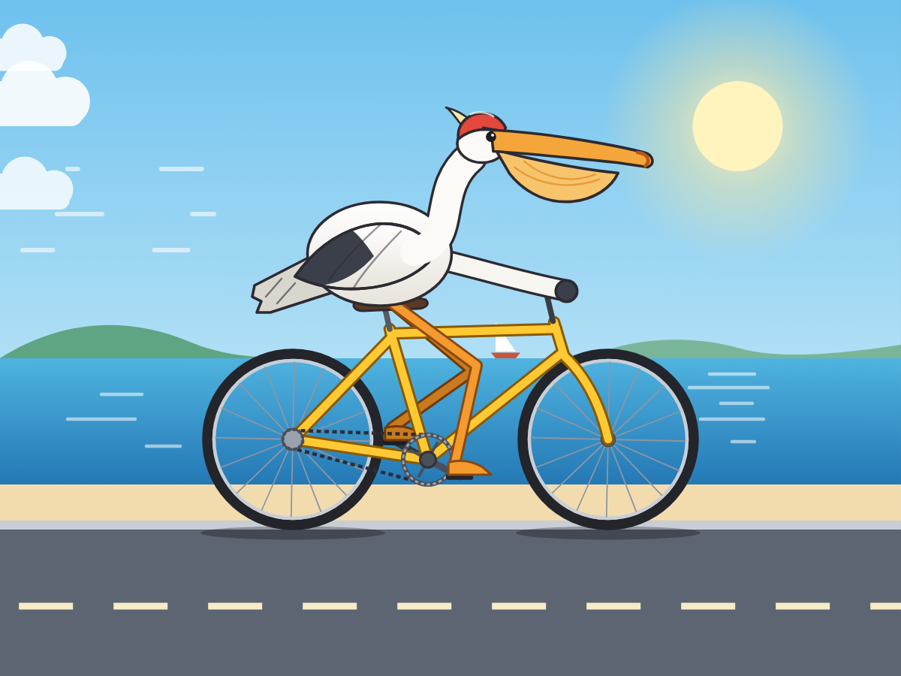

# 🐦 Sonnet 5.5 · 骑自行车的鹈鹕

- **模型**：Sonnet 5.5
- **日期**：2026-10-17
- **提示词**：`Generate an SVG of a pelican riding a bicycle`
- **形式**：单文件 HTML（内联 SVG + 少量 JS / CSS 动画），直接打开 [`index.html`](index.html) 即可
- **生成方式**：一次性生成，没有迭代、没有手动修图（`preview.png` 是同一份 `index.html` 的原样截图）

## ✨ 亮点

- **踏板、腿、车轮、链条共用同一个踏频**：腿是两节骨头的 IK，髋固定在车座上，膝盖永远朝车头方向弯，脚踩在踏板上不会“长进车架里”。
- 远侧 / 近侧两条腿一深一浅，分在车架前后两层，靠颜色就能分出前后。
- 轮子转速按齿比跟着曲柄走，路面的虚线、速度线按车轮的实际滚动距离往后退，不会出现“原地蹬、路在自己跑”。
- 鹈鹕有它该有的东西：S 形脖子、夸张的长喙、会随节奏晃的嘴袋，外加一顶安全头盔。
- 车架和脖子用“同一组路径描两次”（外轮廓 + 内填色），接头自然融合。
- `prefers-reduced-motion` 下会停在固定姿态，不动画。

## 💥 翻车点（没修，原样保留）

- 大腿偏长，从肚子下面直接伸出来，有点像踩高跷的鸟，不太像鹈鹕短而粗的腿。
- 收拢的翅膀上，黑色飞羽落在了身体中段，而不是靠近尾部；尾羽是一块灰色平板，像被压扁的扇子。
- 伸向车把的“翅膀手臂”是一根没有肘部的直管，抓把手的那只“手”就是一个深灰圆球。
- 后飞轮转速是随手拍的倍数，不是严格按齿数算的。
- 膝盖转到最高点时会压在上管上方，位置不算太严谨。
- 背景比较“模板化”：海、沙滩、公路、太阳和云，没有什么构图上的野心。
